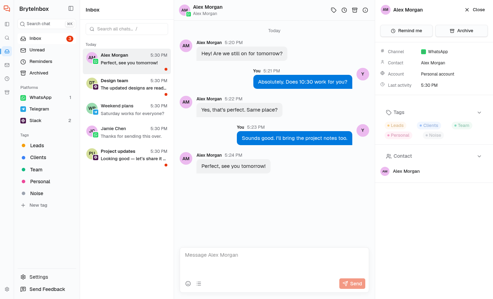

# BryteInbox

One calm inbox for all your direct messages — iMessage, WhatsApp, LinkedIn, Instagram, Telegram, Slack and X — on your own Mac or Windows PC.

BryteInbox is a fast, keyboard-first web app for personal use. It reads your chats from [Beeper Desktop](https://www.beeper.com), a free app that unifies your messaging accounts, and presents them in a clean three-column workspace with tags, reminders, archiving and AI-suggested replies.

> **Private by design:** BryteInbox runs entirely in your browser on your computer. It talks directly to the Beeper Desktop app running on the same machine. Your Beeper access token and your messages never leave your computer — there is no server that stores them.



## What it does

- **One inbox for 7 platforms** — every conversation shows a small platform icon so you always know where a message came from. Filter the list by platform or tag, and search across all chats.
- **Three-column workspace** — navigation rail and tag folders on the left, conversation list in the middle, full message thread with a contact-details panel on the right. Collapses cleanly to smaller screens.
- **Organise your way** — create tags (Leads, Clients, Team, Personal, or your own), give them colours, drag a chat onto a tag to retag it, set reminders ("later today", "tomorrow", "next week", or a custom time), and archive anything you're done with. All of it is saved on your computer and survives a refresh.
- **AI suggested replies (optional)** — turn on "AI suggested drafts" for a tag, and chats with that tag show a greyed "Suggested reply" card above the composer with Use / Edit / Dismiss. Nothing ever sends automatically.
- **Keyboard-first** — `J`/`K` move between chats, `Enter` opens one, `R` jumps to reply, `E` archives, `H` sets a reminder, `T` opens the tag picker, `/` jumps to search, `⌘K`/`Ctrl+K` opens quick search, and `⌘Z`/`Ctrl+Z` undoes a send within a 5-second send window.
- **Installable app** — works as a PWA, so you can install it to your dock or taskbar and run it like a native desktop app.

## Requirements

1. **Beeper Desktop** — free, from [beeper.com](https://www.beeper.com). Sign in and add the messaging accounts you want in BryteInbox.
2. **Node.js 24 or newer** — only needed when running from source. Mac release downloads include their own runtime.

No BryteInbox account, cloud service or environment file is needed. The only credential required is your Beeper Desktop access token, entered locally during setup.

## Download and install on macOS

Once a maintainer publishes a release, open this repository's **Releases** tab:

1. Download `BryteInbox-VERSION-macOS-arm64.zip` for **Apple silicon (M1 or newer)**, or `BryteInbox-VERSION-macOS-x64.zip` for **Intel**. Find your chip under **Apple menu → About This Mac**.
2. Unzip the download and drag **BryteInbox.app** into **Applications**.
3. Open Beeper Desktop, then BryteInbox. Follow the Get started walkthrough and enter your Beeper Desktop access token.

These releases are **ad-hoc signed, not Apple-notarized**. Only install a build from a repository and maintainer you trust. If macOS blocks it, review **System Settings → Privacy & Security → Open Anyway** after trying to open the app. Some managed Macs prohibit this. Do not disable Gatekeeper globally. Downloads include `SHA256SUMS.txt` for integrity checks; checksums do not replace publisher verification.

The desktop app bundles its own screens and talks to Beeper only on this computer. It does not load the published website. Beeper tokens and tags stay in the desktop app's local storage; they are separate from your browser installation. Beeper must remain running. Windows desktop releases are not included in this workflow; Windows users can run the browser version from source.

### Publish a GitHub release (maintainers)

The **macOS releases** workflow builds Apple silicon and Intel apps, runs the tests, and uploads both ZIPs plus checksums to a GitHub Release.

```sh
git tag v1.0.0
git push origin v1.0.0
```

Use `vMAJOR.MINOR.PATCH` tags. You can also open **Actions → macOS releases → Run workflow** and supply an existing version tag. The workflow uses GitHub's automatic token; no cloud credentials, environment file or Apple signing secrets are required. Enable GitHub Actions in the repository if it is disabled. A release is published only after both architecture builds succeed. Rerunning a release replaces its downloads.

To package locally on a Mac with Bun installed:

```sh
bun install --frozen-lockfile
bun run test
bun run test:desktop
bun run build:desktop
node scripts/package-macos.mjs arm64 1.0.0
```

Use `x64` instead of `arm64` for Intel. ZIPs appear in `release/`. The GitHub workflow must complete before any download exists; signing with an Apple Developer identity and notarization are future work.

## Run it on your computer

```sh
git clone https://github.com/YOUR_USERNAME/bryteinbox.git
cd bryteinbox
npm install
npm run dev
```

Then open the printed address (by default `http://localhost:8080`) in your browser.

### Connect your first account

1. In **Beeper Desktop**, open **Settings → Developers** and switch on the API.
2. Create an **access token** there and copy it.
3. BryteInbox opens with a short **Get started** walkthrough — paste the token in, and your real chats appear.
4. Once connected, use the **install** option in your browser (Chrome: *Install app*; Safari/Edge: *Add to Dock / Install*) to run BryteInbox like a normal desktop app.

Notes:

- The connection is per-computer: Beeper Desktop must stay open while you use BryteInbox, and you connect once on each computer you use.
- The token is stored only in your browser on that computer and is sent nowhere except your own machine.

### Optional: production build

```sh
npm run build
npm run preview
```

## Roadmap

- **Now** — personal use via Beeper Desktop, everything local.
- **Next** — [Unipile](https://unipile.com) as a second connection option (hosted, no desktop app needed), which also unlocks multi-user and hosted setups.
- **Later** — accounts, plans and team features for a hosted, monetised product. The code already separates providers (`MessagingProvider` interface) from the UI, so switching or adding a provider doesn't change how the app looks or works.

## Technical notes

- Built with [TanStack Start](https://tanstack.com/start) (React 19), Tailwind CSS v4 and TanStack Query.
- All chats and messages flow through a single `MessagingProvider` interface (`src/providers`); `BeeperProvider` talks to Beeper Desktop's local API.
- Tags, reminders and archived state live in a separate `OrganiserStore` (`src/lib/organiser-store.ts`) using browser localStorage, ready to move to a database later.
- No application sign-in, profile storage or database connection is included in the personal-use app. Hosted accounts can be added later alongside Unipile.

## Privacy

- Messages, accounts and your Beeper token stay on your computer.
- No analytics, no message storage on any server.
- Disconnect Beeper at any time in Settings; BryteInbox then shows nothing and sends nothing.

## Feedback & contributing

This started as a personal project. Ideas and pull requests are welcome — open an issue to discuss what you'd like to see.

## Build with Lovable

This project was built with [Lovable](https://lovable.dev). Continue developing it in the [Lovable editor](https://lovable.dev/projects/4e1013fc-59e7-40ab-a1f9-ea9cdf95b068).

- **Ship faster**: describe what you want to build and Lovable handles the code.
- **Stay in sync**: every change made in Lovable is committed straight to this repository.
- **Full ownership**: this code is yours. Push to `main` on GitHub and your changes sync back into Lovable, ready for your next prompt.
